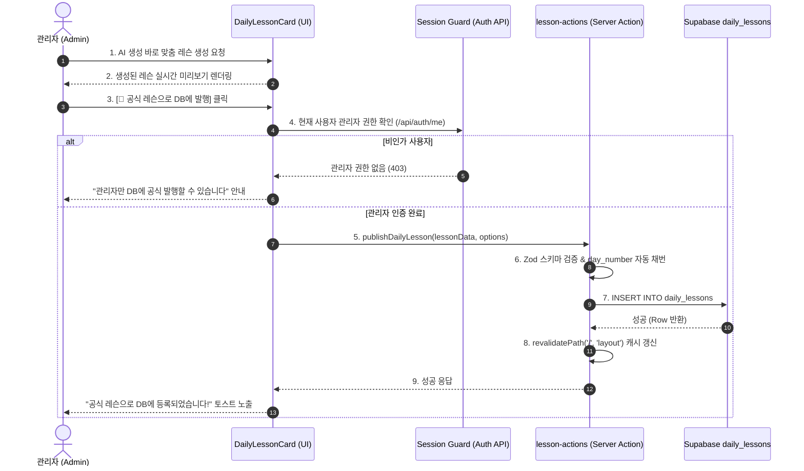

# 📋 AI 학습 레슨 DB 저장 및 아카이빙 관리 기능 구현 계획서
(AI Generated Lesson Persistence & Archiving Implementation Plan)

- **작성일:** 2026-10-16
- **문서 버전:** v1.0
- **저장 경로:** [workspace/ai-lesson-archive-implementation-plan.md](file:///c:/Users/dandycode/Documents/GitHub/busan-dayori/workspace/ai-lesson-archive-implementation-plan.md)
- **대상 테이블:** `public.daily_lessons` (Supabase PostgreSQL)

---

## 1. 추진 배경 및 목표 (Background & Objectives)

### 1.1 현황 및 페인포인트 (Pain Points)
1. **휘발성 데이터 (LocalStorage 종속)**:
   - 현재 AI 생성 레슨은 각 사용자의 브라우저 `localStorage('saved_lessons')`에만 저장됩니다.
   - 기기 변경, 시크릿 모드, 브라우저 캐시 삭제 시 소중한 학습 콘텐츠가 영구 유실됩니다.
2. **AI API 쿼터 및 토큰 비용 비효율**:
   - 유사하거나 동일한 상황(예: "돼지국밥 주문법", "맵기 조절 배려")을 다른 사용자나 관리자가 매번 새로 요청할 때마다 Gemini API를 중복 호출합니다.
3. **플랫폼 콘텐츠 자산화 부족**:
   - 훌륭한 퀄리티로 생성된 일본어 실전 표현과 원어민 뉘앙스 팁이 사이트 전체의 정적 자산(게시판형 아카이브)으로 누적되지 못하고 있습니다.

### 1.2 구현 목표 (Objectives)
- **게시판형 영구 아카이빙**: AI로 생성된 양질의 레슨을 관리자의 승인/발행(Publish)을 거쳐 Supabase DB `daily_lessons` 테이블에 영구 저장.
- **콘텐츠 자산 축적**: 1일차(Day 1)부터 시작해 사용자와 관리자가 생성한 수십~수백 개의 실전 회화 레슨을 축적.
- **편지(`letters`)와의 외래키 연계**: 편지 글과 관련된 레슨을 `related_letter_id`로 연결하여 입체적인 여행-학습 경험 제공.
- **보안 및 권한 보장**: 일반 사용자의 무분별한 DB 오염을 방지하기 위해 엄격한 RLS(Row Level Security) 및 관리자 인증 가드 적용.

---

## 2. 현황 분석 및 갭 분석 (Gap Analysis)

| 구성 요소 | 현재 상태 | 목표 상태 | 필요한 작업 |
|:---|:---|:---|:---|
| **DB 테이블 (`daily_lessons`)** | 스키마 생성 완료 (행 3개) | 스키마 유지 + 인덱스 및 제약 보강 | 인덱스 확인, `slug`/`id` 중복 방지 제약 |
| **DB 보안 (RLS 정책)** | `SELECT`(누구나), `UPDATE`(관리자만) | `INSERT`(관리자), `DELETE`(관리자) 정책 추가 | Supabase RLS 정책 SQL 적용 |
| **백엔드 (Server Action)** | `letter-actions.ts`만 존재 | `lesson-actions.ts` 신설 | `publishDailyLesson`, `deleteDailyLesson` 구현 |
| **API (`generate-lesson`)** | 생성 후 클라이언트에만 반환 | (선택적) 관리자 요청 시 자동 저장 플래그 지원 | 옵션 파라미터 추가 검토 |
| **프론트엔드 UI** | '로컬 보관' 버튼만 존재 | **[📌 공식 DB에 발행]** 버튼 및 관리자 모달 | `DailyLessonCard.tsx`에 발행 인터랙션 추가 |
| **목록/피드 연동** | 초기 3개 및 하드코딩 커리큘럼 표시 | DB에 쌓인 레슨들을 페이지네이션/필터링 노출 | `HomeFeed.tsx` 및 로드맵 탐색 강화 |

---

## 3. 시스템 아키텍처 및 데이터 흐름 (Architecture & Flow)

### 3.1 사용자 및 관리자 시퀀스 흐름


### 3.2 데이터베이스 스키마 및 매핑 구조
`daily_lessons` 테이블은 이미 완성도 높은 JSONB 구조를 갖추고 있습니다:

```sql
-- 테이블 스키마 확인
CREATE TABLE IF NOT EXISTS public.daily_lessons (
    id TEXT PRIMARY KEY,                       -- 예: 'lesson-day-4' 또는 'lesson-ai-{timestamp}'
    day_number INTEGER,                       -- 일차 번호 (null 허용, 자동 증가 지원)
    series_title TEXT NOT NULL,                -- 예: '실전 부산 로컬 교류 편'
    theme_title TEXT NOT NULL,                 -- 예: '돼지국밥 다대기와 부추 넣는 법'
    key_expression JSONB NOT NULL,             -- { japanese, reading, korean }
    dialogue JSONB NOT NULL,                   -- [{ speaker, japanese, korean, pronunciation? }]
    grammar JSONB NOT NULL,                    -- { title, structure, explanation, comparison? }
    vocabulary JSONB NOT NULL,                 -- [{ id, kanji, reading, meaning, partOfSpeech }]
    nuance_tip TEXT,                           -- 원어민 뉘앙스 비교 해설
    related_letter_id TEXT REFERENCES public.letters(id) ON DELETE SET NULL, -- 연관 편지 FK
    created_at TIMESTAMPTZ DEFAULT NOW()
);
```

---

## 4. 단계별 상세 구현 계획 (Implementation Phases)

### 🟩 Phase 1: Supabase RLS 정책 및 DB 권한 설정
- **목적**: 인가된 관리자(`ADMIN_EMAILS`)만 `daily_lessons`를 생성/삭제할 수 있도록 데이터베이스 레벨 보안 강화.
- **실행 작업**:
  - `daily_lessons` 테이블에 `INSERT` RLS 정책 추가:
    ```sql
    CREATE POLICY "Admin insert daily_lessons"
    ON public.daily_lessons
    FOR INSERT
    TO authenticated
    WITH CHECK (
      (auth.jwt() ->> 'email') = ANY (
        ARRAY['ubithus@gmail.com'] -- 또는 환경변수 싱크
      )
    );
    ```
  - `daily_lessons` 테이블에 `DELETE` RLS 정책 추가:
    ```sql
    CREATE POLICY "Admin delete daily_lessons"
    ON public.daily_lessons
    FOR DELETE
    TO authenticated
    USING (
      (auth.jwt() ->> 'email') = ANY (
        ARRAY['ubithus@gmail.com']
      )
    );
    ```

---

### 🟩 Phase 2: 서버 액션 구현 (`src/lib/actions/lesson-actions.ts`)
- **목적**: Server Component 및 Client Component에서 안전하게 레슨을 DB에 영구 등록·수정·삭제하는 단일 진입점 구축.
- **주요 함수 명세**:
  1. `publishDailyLesson(data: PublishLessonInput)`:
     - 관리자 세션 서버 검증 (`isAdminUser()` 확인).
     - 기존 최대 `day_number`를 조회하여 미지정 시 자동으로 `max(day_number) + 1` 할당.
     - 고유 식별자(`id`) 충돌 방지 처리 (`lesson-day-{dayNumber}` 또는 고유 slug).
     - Supabase `daily_lessons` 테이블에 insert.
     - Next.js 태그 및 패스 재검증 (`revalidatePath('/')`, `revalidatePath('/voca')`).
  2. `deleteDailyLesson(id: string)`:
     - 관리자 권한 확인 후 해당 레슨 삭제.
  3. `updateDailyLesson(id: string, data: Partial<DailyLesson>)`:
     - 등록된 레슨 내용 수정 (오탈자 수정 및 표현 보강).

---

### 🟩 Phase 3: 프론트엔드 UI/UX 인터랙션 구현
- **대상 컴포넌트**: [DailyLessonCard.tsx](file:///c:/Users/dandycode/Documents/GitHub/busan-dayori/src/components/daily/DailyLessonCard.tsx)
- **주요 작업**:
  1. **관리자 인증 상태 연동**:
     - 기존 `/api/auth/me`를 활용해 접속자가 관리자인지 여부(`isAdmin`) 파악.
  2. **발행 액션 버튼 배치**:
     - AI가 생성한 레슨인 경우(`isAiGenerated === true`), 기존 '보관(LocalStorage)' 버튼 옆에 **[📌 공식 DB 발행]** 버튼을 강조 표시.
  3. **발행 옵션 모달/드롭다운 (선택 사항)**:
     - Day 번호 지정 (자동 추천 번호 제공).
     - 관련 부산 편지(`related_letter_id`) 선택 연동 드롭다운.
  4. **시각적 피드백**:
     - 발행 진행 중 `Loader2` 로딩 스피너 및 비활성화 처리.
     - 발행 완료 시 초록색 배지 전환(`공식 발행 완료`) 및 토스트 알림 발송.

---

### 🟩 Phase 4: 홈 피드 및 레슨 아카이브 탐색 확장
- **대상 컴포넌트**: [HomeFeed.tsx](file:///c:/Users/dandycode/Documents/GitHub/busan-dayori/src/components/home/HomeFeed.tsx), [queries.ts](file:///c:/Users/dandycode/Documents/GitHub/busan-dayori/src/lib/supabase/queries.ts)
- **주요 작업**:
  1. `getDailyLessons()` 쿼리를 통해 DB에 저장된 모든 공식 레슨을 최신순 또는 Day 순으로 조회.
  2. 홈 화면 상단의 레슨 선택기 또는 칩 바에서 DB에 누적된 레슨들을 직관적으로 전환하며 볼 수 있도록 개선.
  3. 향후 레슨 수가 30~50개를 넘어갈 경우를 대비해 카테고리별(식당/교통/골목/문화) 필터 탭 지원.

---

## 5. 검증 및 테스트 시나리오 (Verification Scenarios)

| 번호 | 테스트 케이스 | 예상 결과 |
|:---:|:---|:---|
| **TC-01** | 비로그인 / 일반 사용자 상태에서 AI 레슨 생성 후 DB 발행 시도 | 발행 버튼이 미노출되거나, 클릭 시 "관리자 로그인이 필요합니다" 안내와 함께 403 차단 |
| **TC-02** | 관리자 로그인 상태에서 AI 레슨 생성 후 DB 발행 클릭 | Server Action을 통해 `daily_lessons`에 즉시 INSERT 성공, DB에 행 추가 |
| **TC-03** | 새로고침 및 다른 기기/시크릿 창에서 메인 접속 | 방금 DB에 발행된 레슨이 피드 또는 목록에 온전히 노출되며 0ms 속도로 로드 |
| **TC-04** | 발음(TTS) 및 단어장 스크랩 동작 검증 | DB에 저장된 레슨 내 어휘와 대화문도 기존처럼 TTS 재생 및 단어장 보관 정상 작동 |
| **TC-05** | 중복 ID 또는 유효하지 않은 데이터 입력 시 | Zod 유효성 검증에서 캐치되어 사용자 친화적 에러 메시지 반환 및 무결성 유지 |

---

## 6. 향후 발전 방향 (Future Extensions)

1. **원어민 첨삭/피드백 연계**:
   - DB에 공식 등록된 레슨마다 독자 첨삭 위젯(`FeedbackWidget`)을 부착하여, 일본인 독자가 추가적인 자연스러운 표현 팁을 댓글처럼 달 수 있도록 확장.
2. **편지 상세 페이지 하단 추천**:
   - 예: "해운대 해변열차 편지" 하단에 `related_letter_id`로 연결된 "블루라인파크 티켓 구매 실전 대화 레슨"을 자동 추천 카드로 바인딩.
3. **학습자 진도율 체크 연동**:
   - 사용자가 Day 1부터 축적된 DB 레슨들을 하나씩 '학습 완료' 체크하며 진도율 배지를 획득하는 게이미피케이션 요소 접목.
