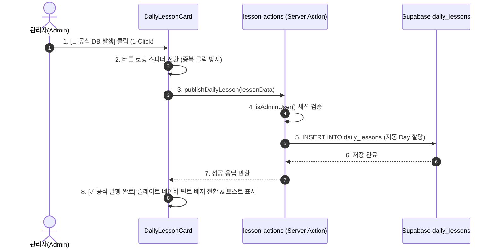

# 📋 AI 학습 레슨 DB 저장 및 로드맵 'AI+' 무한 누적 구현 계획서
(AI Generated Lesson Persistence & 'AI+' Endless Roadmap Implementation Plan)

- **작성일:** 2026-10-16 (업데이트: 2026-10-17)
- **문서 버전:** v1.3 (DESIGN.md 디자인 시스템 & Karpathy Guidelines 통합판)
- **저장 경로:** [workspace/ai-lesson-archive-implementation-plan.md](file:///c:/Users/dandycode/Documents/GitHub/busan-dayori/workspace/ai-lesson-archive-implementation-plan.md)
- **대상 테이블:** `public.daily_lessons` (Supabase PostgreSQL)
- **핵심 원칙:** 
  1. **Engineering (Karpathy):** Think Before Coding, Simplicity First, Surgical Changes, Goal-Driven Execution
  2. **Design (DESIGN.md):** 따뜻한 종이 감성(Warm Canvas), 4단계 웜톤 농도 + 슬레이트 네이비 액센트, 신호등 원색 혼용 금지, 주체적 다짐형 톤앤매너, 모바일 360px 텍스트 무결점 보장

---

## 1. 추진 배경 및 목표 (Background & Objectives)

### 1.1 현황 및 페인포인트 (Pain Points)
1. **휘발성 데이터 (LocalStorage 종속)**:
   - 현재 AI 생성 레슨은 각 사용자의 브라우저 `localStorage('saved_lessons')`에만 저장됩니다.
   - 기기 변경, 시크릿 모드, 캐시 삭제 시 소중한 학습 콘텐츠가 영구 유실됩니다.
2. **정적 로드맵의 한계 (Lv.0 ~ Lv.3 고정)**:
   - 현재 일본어 챌린지 로드맵([/roadmap](file:///c:/Users/dandycode/Documents/GitHub/busan-dayori/src/app/roadmap))은 4개 단계(`Lv.0 입문`, `Lv.1 초급`, `Lv.2 중급`, `Lv.3 실전`)로 고정되어 있어, 학습자가 원하는 새로운 상황을 확장해 나가는 동적인 재미가 부족합니다.
3. **AI API 쿼터 및 토큰 비용 비효율**:
   - 유사하거나 동일한 상황(예: "돼지국밥 주문법", "맵기 배려하기")을 매번 새로 요청할 때마다 Gemini API를 중복 호출합니다.
4. **플랫폼 콘텐츠 자산화 부족**:
   - 훌륭한 퀄리티로 생성된 일본어 실전 표현과 원어민 뉘앙스 팁이 사이트 전체의 정적 자산(게시판형 아카이브)으로 누적되지 못하고 있습니다.

### 1.2 구현 목표 (Objectives)
- **로드맵 5번째 단계 'AI+' 신설**:
  - 기존 4단계에 이어 **`AI+`** 탭을 추가하고, 상단 생성 바를 통해 새로운 레슨을 만들면 **Unit 1, Unit 2, Unit 3... 형태로 무한히 카드가 누적**되는 동적 로드맵(Endless Roadmap) 구현.
- **게시판형 영구 아카이빙**:
  - AI로 생성된 양질의 레슨을 관리자의 승인/발행(Publish)을 거쳐 Supabase DB `daily_lessons` 테이블에 영구 저장.
- **콘텐츠 자산 축적 & 비용 절감**:
  - 한번 DB에 저장된 레슨은 모든 방문자가 0ms 속도로 즉시 조회 가능하도록 최적화.

---

### 1.3 기술적 가정 및 디자인 결정 사항 (Assumptions & Design Choices)

[DESIGN.md](file:///c:/Users/dandycode/Documents/GitHub/busan-dayori/DESIGN.md) 및 Karpathy 원칙 1에 따라 구현 전 핵심 전제와 디자인 선택을 명시합니다.

| 분류 | 내용 및 결정 사항 | 선정 이유 및 가이드라인 부합성 |
|:---|:---|:---|
| **AI+ 테마 컬러** | • **슬레이트 네이비 (`#3D5A80`)**<br>• 연한 배경: 틴트 (`#EBF3FB`)<br>• 테두리: 소프트 슬레이트 (`#C5D9F2`) | • **DESIGN.md 2.3절 준수**: 임의의 보라색/인디고 대신, 일본어 문화 및 액센트를 담당하는 브랜드 고유 세컨더리 팔레트 계승<br>• **Don'ts 1 준수**: 채도 높은 이질적 원색 배제 |
| **상태 피드백 배지** | • 발행 완료 배지: 슬레이트 틴트(`bg-[#EBF3FB] text-[#3D5A80] border-[#C5D9F2]`) 또는 코랄 틴트(`bg-[#FAF0E6] text-[#E07A5F]`) | • **DESIGN.md 2.4/4.5절 준수**: 차가운 신호등 형광 초록을 배제하고 따뜻한 종이 감성(Warm Canvas) 유지 |
| **모바일 5분할 탭** | • `grid-cols-5`, `text-[11px]`, `tracking-tight`, `px-1.5`<br>• 최소 터치 타깃 36px 이상 확보 | • **DESIGN.md 4.2/5장 준수**: 360px 초소형 모바일 화면에서도 글자 줄바꿈 깨짐 없이 단정하게 1행 균등 배치 |
| **톤앤매너 (문구)** | • 상업적 권유형(`~해보세요`) 배제<br>• 주체적 다짐형(`~합니다`, `~채워갑니다`) 통일 | • **DESIGN.md 1.3절/6.1절 준수**: 다정한 다이어리 및 챌린지 일기 톤앤매너 유지 |
| **데이터 통합 전략** | • DB 공식 레슨(`daily_lessons`)을 기본 서버 fetch<br>• 브라우저 로컬 레슨(`saved_lessons`) 중 미발행 건만 클라이언트에서 상단 병합(Merge) | • 모든 방문자 공통 콘텐츠 즉시 노출 + 본인 임시 레슨 실시간 확인 가능 |
| **발행 인터랙션** | • 1-Click 즉시 발행 (복잡한 팝업 모달, 편지 드롭다운 배제) | • **Simplicity First**: 코드 복잡도 최소화 및 원터치 발행 경험 제공 |

---

## 2. 현황 분석 및 갭 분석 (Gap Analysis)

| 구성 요소 | 현재 상태 | 목표 상태 (MVP) | 변경 범위 (Surgical) |
|:---|:---|:---|:---|
| **로드맵 단계** | 4단계 (`Lv.0` ~ `Lv.3`) | **5단계 (`Lv.0` ~ `Lv.3` + `AI+`)** | `LessonLevel`에 `'ai'` 추가, 5분할 탭 바 레이아웃 추가 |
| **로드맵 인터랙션** | 고정된 정적 유닛만 노출 | **상단 생성기 + 생성된 레슨 유닛 누적** | [RoadmapView.tsx](file:///c:/Users/dandycode/Documents/GitHub/busan-dayori/src/components/roadmap/RoadmapView.tsx)에 `selectedLevel === 'ai'` 분기 격리 |
| **디자인 테마** | 4단계 웜톤 농도 체계 | **4단계 웜톤 + 슬레이트 네이비 AI+ 테마** | [DESIGN.md](file:///c:/Users/dandycode/Documents/GitHub/busan-dayori/DESIGN.md) 세컨더리 토큰(`#3D5A80`) 100% 매핑 |
| **DB 테이블 (`daily_lessons`)** | 스키마 완비 (기존 레코드 존재) | 스키마 유지 + 관리자 쓰기 권한 추가 | 기존 컬럼 변경 없음, INSERT/DELETE RLS 정책만 추가 |
| **백엔드 (Server Action)** | `letter-actions.ts`만 존재 | `lesson-actions.ts` 신설 | `publishDailyLesson`, `deleteDailyLesson` 2개 함수만 구현 |
| **프론트엔드 UI** | '로컬 보관' 버튼만 존재 | **[📌 공식 DB 발행]** 원클릭 웜톤 버튼 | [DailyLessonCard.tsx](file:///c:/Users/dandycode/Documents/GitHub/busan-dayori/src/components/daily/DailyLessonCard.tsx)에 관리자 전용 원버튼 추가 |

---

## 3. 시스템 아키텍처 및 화면 설계 (UI & Architecture)

### 3.1 로드맵 'AI+' 탭 화면 레이아웃 (DESIGN.md 규격)

```
[ 상단 로드맵 5단계 탭 (모바일 360px 대응 5분할 grid-cols-5 최적화) ]
┌───────────┬───────────┬───────────┬───────────┬───────────┐
│ 👶 Lv.0   │ ✨ Lv.1   │ ⚡ Lv.2   │ 🔥 Lv.3   │ 🪄 AI+    │ ⬅️ [3글자 컴팩트 / text-[11px]]
│   입문    │   초급    │   중급    │   실전    │   확장    │
└───────────┴───────────┴───────────┴───────────┴───────────┘

[ 'AI+' 탭 활성화 시 화면 구성 (슬레이트 네이비 #3D5A80 테마) ]

┌─────────────────────────────────────────────────────────────┐
│ 🪄 AI+ 실전 로컬 챌린지 (무제한 확장)                          │
│ "일본인 친구에게 들려주고 싶은 나만의 부산 이야기를 AI와 함께       │
│  실전 일본어로 기록하고 차곡차곡 채워갑니다."                   │
│                                                             │
│ ┌──────────────────────────────────────────────┐ ┌──────┐   │
│ │ 예: 테지크ッパ 먹는 법 설명, 매운 음식 배려...   │ │ 생성 │   │
│ └──────────────────────────────────────────────┘ └──────┘   │
│ 🏷️ [부산 미식 추천]  🏷️ [맵기 배려]  🏷️ [지하철 길안내]...   │
└─────────────────────────────────────────────────────────────┘

▼ 지금까지 생성 및 축적된 AI 레슨 유닛 목록 (생성할 때마다 최상단 추가)

┌─────────────────────────────────────────────────────────────┐
│ UNIT 1 : 釜山グルメのおすすめ                               │
│ 🗣️ "テジクッパの美味しい食べ方を教えたい！"                  │
│ [🔊 발음 듣기]  [이 유닛 학습하기 ➡️]                        │
└─────────────────────────────────────────────────────────────┘
┌─────────────────────────────────────────────────────────────┐
│ UNIT 2 : 辛さの気遣い・注文                                │
│ 🗣️ "辛いものは大丈夫ですか？ 辛さ控えめにできますよ"        │
│ [🔊 발음 듣기]  [이 유닛 학습하기 ➡️]                        │
└─────────────────────────────────────────────────────────────┘
```

### 3.2 1-Click 발행 시퀀스 흐름 (Warm Tone Feedback)


---

## 4. 단계별 상세 구현 및 검증 루프 (Goal-Driven Execution)

각 단계는 독립적으로 검증 가능하도록 `[Step] → verify: [check]` 형식으로 진행됩니다.

### 🟩 Phase 1: Supabase RLS 정책 및 DB 권한 설정
- **원칙**: 기존 테이블 구조를 전혀 변경하지 않고, 인가된 관리자만 쓰기/삭제가 가능하도록 정책만 주입.
- **실행 단계**:
  ```text
  1. [Step] Supabase SQL 에디터에 daily_lessons INSERT/DELETE RLS 정책 작성
     → verify: 비로그인 또는 일반 유저 세션에서 INSERT 쿼리 실행 시 42501 (Permission Denied) 확인
  2. [Step] 관리자 이메일(ADMIN_EMAILS)로 인증된 토큰으로 INSERT 테스트
     → verify: 정상적으로 행이 삽입되는지 Supabase Table Editor에서 확인
  ```
- **적용 SQL**:
  ```sql
  -- 관리자 전용 INSERT 정책
  CREATE POLICY "Admin insert daily_lessons"
  ON public.daily_lessons
  FOR INSERT
  TO authenticated
  WITH CHECK (
    (auth.jwt() ->> 'email') = ANY (ARRAY['ubithus@gmail.com'])
  );

  -- 관리자 전용 DELETE 정책
  CREATE POLICY "Admin delete daily_lessons"
  ON public.daily_lessons
  FOR DELETE
  TO authenticated
  USING (
    (auth.jwt() ->> 'email') = ANY (ARRAY['ubithus@gmail.com'])
  );
  ```

---

### 🟩 Phase 2: 서버 액션 구현 (`src/lib/actions/lesson-actions.ts`)
- **원칙**: 불필요한 `update` 기능이나 모달 폼 전송을 배제하고, `publish`와 `delete` 2개의 순수 액션만 구축.
- **실행 단계**:
  ```text
  1. [Step] lesson-actions.ts 파일 신설 및 publishDailyLesson 함수 작성
     → verify: 관리자가 아닐 때 Error('Unauthorized')가 반환되는지 확인
  2. [Step] max(day_number) 자동 계산 및 고유 ID 생성 로직 구현
     → verify: 기존 day_number 최대값이 3일 때 새 레슨에 day_number: 4가 지정되는지 확인
  3. [Step] deleteDailyLesson 함수 작성
     → verify: 관리자 호출 시 대상 ID 레코드가 삭제되고 revalidatePath가 호출되는지 확인
  ```
- **구현 명세**:
  ```typescript
  'use server';

  export async function publishDailyLesson(lesson: DailyLesson) {
    // 1. 관리자 권한 확인 (isAdminUser)
    // 2. day_number 미지정 시 max(day_number) + 1 자동 채번
    // 3. Supabase INSERT 실행
    // 4. revalidatePath('/roadmap'), revalidatePath('/') 호출
    // 5. { success: true, data } 반환
  }

  export async function deleteDailyLesson(id: string) {
    // 1. 관리자 권한 확인
    // 2. Supabase DELETE 실행
    // 3. revalidatePath 호출
  }
  ```

---

### 🟩 Phase 3: 프론트엔드 UI - 1-Click 발행 인터랙션 구현 (DESIGN.md 준수)
- **원칙 (DESIGN.md & Surgical Changes)**: 
  - [DailyLessonCard.tsx](file:///c:/Users/dandycode/Documents/GitHub/busan-dayori/src/components/daily/DailyLessonCard.tsx)의 기존 레이아웃을 깨지 않고 `isAiGenerated`일 때 보관 버튼 옆에 조건부 렌더링.
  - 신호등 초록색 금지 ❌ ➡️ 슬레이트 네이비 틴트(`bg-[#EBF3FB] text-[#3D5A80] border-[#C5D9F2]`) 적용.
- **실행 단계**:
  ```text
  1. [Step] DailyLessonCard에 isAdmin prop 또는 세션 연동 추가
     → verify: 일반 사용자에게는 [📌 공식 DB 발행] 버튼이 노출되지 않는지 확인
  2. [Step] 관리자에게 [📌 공식 DB 발행] 버튼 노출 및 원클릭 핸들러 바인딩
     → verify: 클릭 시 로딩 스피너(Loader2) 회전 및 버튼 비활성화 확인
  3. [Step] 발행 성공 시 UI 상태 업데이트
     → verify: 버튼이 [✓ 공식 발행 완료] 슬레이트 네이비 틴트 배지로 전환되고 중복 클릭 차단되는지 확인
  ```

---

### 🟩 Phase 4: 로드맵 'AI+' 탭 신설 및 무한 유닛 누적 (핵심 과업)
- **원칙 (DESIGN.md & Surgical Changes)**: 
  - 테마 컬러는 [DESIGN.md](file:///c:/Users/dandycode/Documents/GitHub/busan-dayori/DESIGN.md) 세컨더리 슬레이트 네이비(`color: '#3D5A80'`, `bgLight: '#EBF3FB'`, `borderColor: '#C5D9F2'`) 사용.
  - 모바일(360px)에서 줄바꿈이 깨지지 않도록 `text-[11px]`, `tracking-tight`, `px-1.5` 패딩 적용.
  - 기존 Lv.0 ~ Lv.3 정적 커리큘럼 렌더링 로직은 일체 손대지 않고, `'ai'` 탭 분기만 격리 신설.
- **타깃 파일**:
  - [src/types/index.ts](file:///c:/Users/dandycode/Documents/GitHub/busan-dayori/src/types/index.ts): `LessonLevel`에 `'ai'` 추가
  - [src/lib/curriculum/curriculumData.ts](file:///c:/Users/dandycode/Documents/GitHub/busan-dayori/src/lib/curriculum/curriculumData.ts): `curriculumLevels` 배열 5번째 항목 정의
  - [src/components/roadmap/RoadmapView.tsx](file:///c:/Users/dandycode/Documents/GitHub/busan-dayori/src/components/roadmap/RoadmapView.tsx): 5분할 탭 및 AI+ 전용 뷰 렌더링
- **실행 단계**:
  ```text
  1. [Step] LessonLevel에 'ai' 추가 및 curriculumLevels에 슬레이트 네이비 메타데이터 정의
     → verify: TypeScript 컴파일 에러(tsc --noEmit) 없음 확인
  2. [Step] RoadmapView 탭 그리드를 grid-cols-5로 확장 및 모바일 360px 스타일 튜닝
     → verify: 모바일 뷰포트(360px~390px)에서 5개 탭이 줄바꿈 없이 1줄로 단정하게 표시되는지 확인
  3. [Step] selectedLevel === 'ai'일 때 상단 AiGeneratorBar 임베드
     → verify: AI+ 탭 진입 시 슬레이트 네이비 테마 헤더 및 상황 생성기가 정상 노출되는지 확인
  4. [Step] DB 공식 레슨 목록을 CurriculumUnit 형태로 변환하여 카드 목록 렌더링
     → verify: DB에 등록된 레슨들이 UNIT 1, UNIT 2... 형태로 순서대로 카드 렌더링되는지 확인
  5. [Step] 상단 생성기 완료 시 로컬 상태(lessons) 최상단에 prepend
     → verify: 생성 즉시 페이지 새로고침 없이 최상단에 새 카드가 부드럽게 노출되는지 확인
  ```

---

### 🟩 Phase 5: (안정화 후 선택적 후속 작업) 단어장 및 피드 딥링크 연계
- **원칙 (Simplicity First)**: Phase 1~4가 완벽히 검증된 후 진행하여 1차 배포 리스크 분산.
- **실행 단계**:
  ```text
  1. [Step] AI+ 유닛 카드의 "이 유닛 학습하기" 클릭 시 상세 모달 또는 홈 피드 이동 처리
     → verify: 해당 레슨 카드가 활성화되어 TTS 및 루비 텍스트가 정상 제공되는지 확인
  ```

---

## 5. 종합 검증 시나리오 (Verification Matrix)

| ID | 검증 항목 | 세부 절차 | 합격 기준 (Success Criteria) |
|:---:|:---|:---|:---|
| **TC-01** | **모바일 탭 레이아웃 (360px)** | 브라우저 폭을 360px로 줄이고 `/roadmap` 접속 | `Lv.0`~`Lv.3`, `AI+` 5개 탭이 글자 잘림이나 줄바꿈 없이 1행에 균등 정렬 |
| **TC-02** | **AI+ 탭 뷰 진입 (DESIGN.md)** | 상단 5번째 `AI+` 탭 클릭 | 슬레이트 네이비(`#3D5A80`) 테마 헤더, 상단 생성기 바, 하단 누적 유닛 리스트 노출 (보라색/형광색 일체 없음) |
| **TC-03** | **실시간 유닛 누적** | 상단 생성기에서 새 상황(예: "밀면 육수 리필") 생성 | API 응답 후 페이지 새로고침 없이 최상단에 즉시 새 카드 추가 |
| **TC-04** | **비관리자 권한 격리** | 일반 로그인 또는 비로그인 상태로 진입 | [📌 공식 DB 발행] 버튼이 미노출되며, 직접 액션 호출 시 403 차단 |
| **TC-05** | **관리자 1-Click 발행** | 관리자 계정으로 접속 후 [📌 공식 DB 발행] 클릭 | 로딩 스피너 표시 ➡️ DB INSERT ➡️ 슬레이트 네이비 틴트 배지(`bg-[#EBF3FB] text-[#3D5A80]`) 전환 |
| **TC-06** | **영구 보존 검증** | 브라우저 캐시 및 LocalStorage 전체 삭제 후 새로고침 | DB에 발행된 레슨은 사라지지 않고 그대로 UNIT 목록에 유지 |
| **TC-07** | **기존 기능 회귀 검증** | `Lv.0`, `Lv.1`, `Lv.2`, `Lv.3` 탭 각각 클릭 | 기존 4개 레벨의 커리큘럼 아코디언 및 유닛 카드가 기존과 100% 동일하게 동작 |

---

## 6. 자가 점검 체크리스트 (Engineering & Design)

### 🛠️ Karpathy Guidelines
- [x] **Think Before Coding**: 데이터 병합 기준, 1-Click 발행 정책, 가상화 배제 등 주요 가정을 사전 정의했는가?
- [x] **Simplicity First**: 불필요한 모달, 폼, 수정 액션(`updateDailyLesson`)을 덜어내고 최소 코드로 작성하도록 설계했는가?
- [x] **Surgical Changes**: 기존 Lv.0~Lv.3 탭 로직을 훼손하지 않고 `'ai'` 분기만 격리하여 변경하도록 타깃을 한정했는가?
- [x] **Goal-Driven Execution**: 각 Phase마다 `[Step] → verify: [check]` 형식의 독립 검증 루프를 명시했는가?

### 🎨 DESIGN.md 규격
- [x] **신호등 원색 배제**: 보라색(`#6366F1`) 및 형광 초록을 배제하고 브랜드 세컨더리 **슬레이트 네이비 (`#3D5A80`)** 테마를 채택했는가?
- [x] **모바일 텍스트 잘림 방지**: 360px 초소형 모바일 뷰포트에서도 5분할 탭이 깨지지 않도록 라벨 규격을 설계했는가?
- [x] **다정한 톤앤매너**: 상업적 권유형(`~해보세요`)을 배제하고 주체적 다짐형(`~채워갑니다`) 문구로 통일했는가?
- [x] **따뜻한 종이 감성(Warm Canvas)**: 카드 모서리(`rounded-3xl`), 테두리(`border-[#C5D9F2]`), 은은한 섀도우 규격을 준수했는가?

